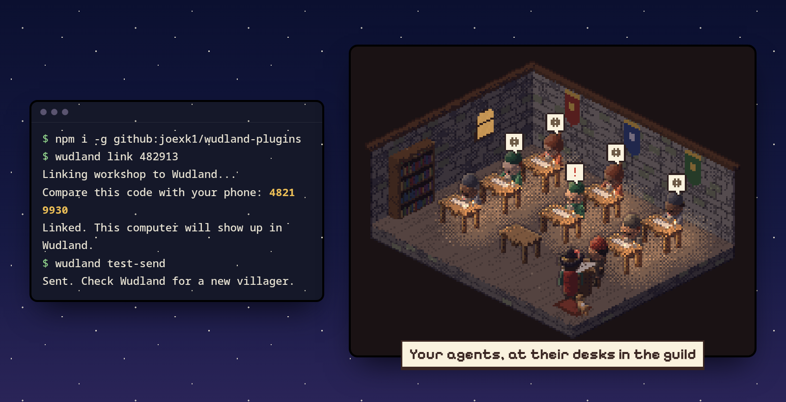
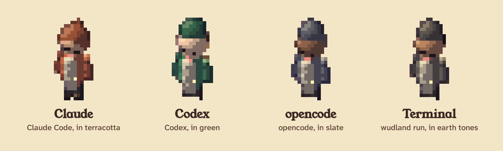
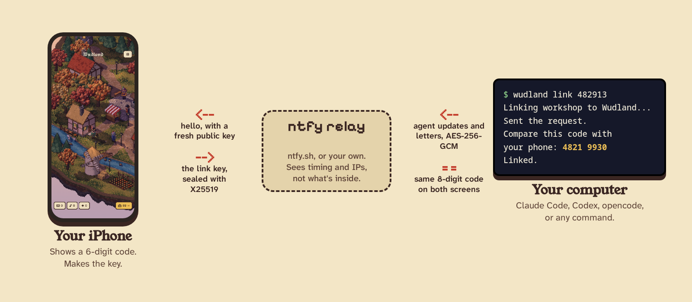
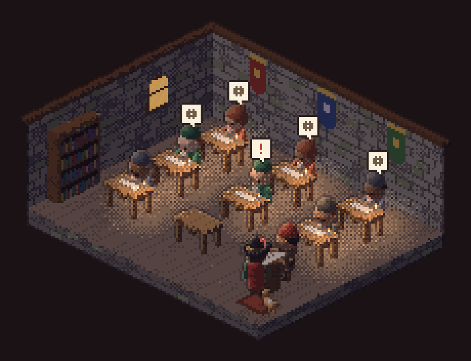

<p align="center">
  
</p>

<h1 align="center">Wudland Link</h1>

<p align="center">The bit on your computer that puts your coding agents in the village.</p>

<p align="center"><a href="https://wudland.pages.dev"><b>wudland.pages.dev</b></a> · <a href="https://github.com/joexk1/wudland">The iPhone app</a></p>



## What it is

[Wudland](https://github.com/joexk1/wudland) is a small pixel village on your iPhone. This repo tells it what the agents on your computer are up to, and each one gets a desk in the Artificers' Guild: working, waiting for you, finished or in trouble.

It works with Claude Code, Codex, opencode and anything else you can run in a terminal. There's no account and no Wudland server. Updates go through an ntfy relay and are encrypted before they leave your machine.



Villagers are named after the tool they came from: Claude, Codex, opencode, Antigravity, Bonsai, and Terminal for anything wrapped with `wudland run`. Anything else gets its source name, capitalised. A subagent sits next to its parent as Claude's apprentice (or Codex's, and so on).

## Install

First the command-line tool. It does the linking, and the Codex and opencode plugins call it. You need Node 18 or newer.

```sh
npm i -g github:joexk1/wudland-plugins
```

If npm refuses GitHub packages with `EALLOWGIT`, allow it for this one command:

```sh
npm i -g --allow-git=root github:joexk1/wudland-plugins
```

Then add whichever agents you use.

<table>
  <tr>
    <td width="50%" valign="top">
      <h3>Claude Code</h3>
      <p>From inside Claude Code:</p>
<pre>/plugin marketplace add joexk1/wudland-plugins
/plugin install wudland@wudland</pre>
      <p>The plugin carries its own copy of the code, so it works without the global install. In that case, link with <code>/wudland:link 123456</code> from inside Claude Code.</p>
    </td>
    <td width="50%" valign="top">
      <h3>Codex</h3>
      <p>Add one line to <code>~/.codex/config.toml</code>:</p>
<pre>notify = ["wudland", "codex-notify"]</pre>
      <p>Newer Codex versions also have hooks, which give live status. How to set those up, and how to keep an existing notify program, is in <a href="codex/README.md">codex/README.md</a>.</p>
    </td>
  </tr>
  <tr>
    <td width="50%" valign="top">
      <h3>opencode</h3>
      <p>Copy the plugin into opencode's plugin folder:</p>
<pre>mkdir -p ~/.config/opencode/plugin
cp opencode/wudland.js ~/.config/opencode/plugin/</pre>
      <p>Use <code>.opencode/plugin/</code> in a project if you only want it there. It calls the <code>wudland</code> command, so keep the global install.</p>
    </td>
    <td width="50%" valign="top">
      <h3>Anything else</h3>
      <p>Wrap any command. The villager is busy while it runs, then done or failed when it exits:</p>
<pre>wudland run -- aider
wudland run --name "Nightly import" -- ./import.sh</pre>
      <p>For more control from a script: <code>wudland emit --src myscript --state busy --name "Thing" --note "Step 2"</code>.</p>
    </td>
  </tr>
</table>

## Linking



1. In Wudland, open **Settings → Link a computer**. It shows a six-digit code that changes every minute.
2. On the computer, run `wudland link 123456` with that code.
3. Both screens then show the same eight-digit code. If they match, tap **Codes match** on the phone. If they don't, deny it.

The computer says "Waiting for you to approve on your phone" until you do. After that, `wudland test-send` should put a villager in the guild:



You link once per computer, and every agent on it shares that link. Linking two phones works too.

## Letters

Scripts can post a note to the Raven Post:

```sh
wudland letter "Backup finished" "Documents copied at 03:00."
```

[scripts/backup-letter.sh](scripts/backup-letter.sh) is a cron example.

## What gets sent

Each update has the session's title, the folder it's in, its state, the last tool used, how many tools it has run, the model, a short note like "Edited src/auth.ts", and the computer's name. That's all.

It never sends file contents, command lines, prompts beyond a 60-character title, or the agent's replies.

- **Encrypted end to end.** Updates and letters are sealed with AES-256-GCM. The key is made by your phone and handed over inside an X25519 key exchange when you link. The eight-digit code is how you check nobody swapped the keys in the middle.
- **The relay** (ntfy.sh by default) sees topic names, network metadata and the sealed payloads. While pairing it also sees the computer's label, the tool kind and the public keys.
- **Titles can go.** `wudland config titles off` sends the folder name instead of your prompt, and drops file names from notes.
- **Your own relay.** `wudland config relay https://ntfy.example.com`. The phone has to use the same one.
- **Hooks never wait on the network.** They make a quick update to local state, send from a background process, and do nothing at all if you haven't linked.

## Protocol in brief

| Step | What happens |
| --- | --- |
| Discovery | The phone's six-digit code is a TOTP (HMAC-SHA1, 60 s). The computer posts a `hello` with a fresh X25519 public key to a topic derived from it. |
| Key exchange | The phone answers with its own public key. Both sides derive a key with HKDF-SHA256 and show an eight-digit code from it. That code never touches the relay. |
| Welcome | Once you tap **Codes match**, the phone sends the link (inbox topic and a random 32-byte key) sealed with the derived key. It's saved in `~/.config/wudland/link.json`, mode 0600. |
| Events | Each update is `w1.` plus an AES-256-GCM box posted to the inbox. States are `busy`, `waiting`, `idle`, `done` and `failed`. |
| Reading | The app polls every 8 seconds while open, drops anything that won't decrypt or is stale, and puts sessions to sleep after 45 quiet minutes. |

The full wire format is in [PROTOCOL.md](PROTOCOL.md), and `test/vectors.json` has fixed keys and boxes for checking another implementation.

## Limits

The public relay is generous but not unlimited, so it keeps to about 250 messages a day:

- A state change goes out straight away, at most once every 5 seconds per session.
- Tool progress goes out at most every 3 minutes.
- After 180 messages in a UTC day, only state changes are sent. After 240, nothing until tomorrow.
- A failed send is retried once, then dropped.

`wudland status` shows today's count. A self-hosted relay has no such limits, but the numbers stay the same.

## Commands

```text
wudland link <code>        link this computer
wudland unlink             remove the link
wudland status             show the link, settings and today's count
wudland letter "T" "B"     post a letter
wudland config             titles on|off, relay URL, host NAME
wudland emit               send one update from a script
wudland run -- <cmd>       wrap any command
wudland test-send          send a test villager
```

Settings live in `~/.config/wudland/` (`link.json` and `state.json`, both readable only by you).

## Uninstall

```sh
wudland unlink
npm rm -g wudland-link
```

For Claude Code, run `/plugin uninstall wudland@wudland`. For Codex, remove the `notify` line or the hooks. For opencode, delete `wudland.js` from the plugin folder. Then remove the computer in the app too.

## Development

```sh
npm test
npm run build:plugins
```

The shared code lives in `lib/`. `build:plugins` copies it into `claude-code/lib/`, because Claude Code copies a plugin into its own cache and it has to carry everything it needs. A test fails if that copy is stale.

## Licence

MIT. See [LICENSE](LICENSE). The app itself is GPLv3.
